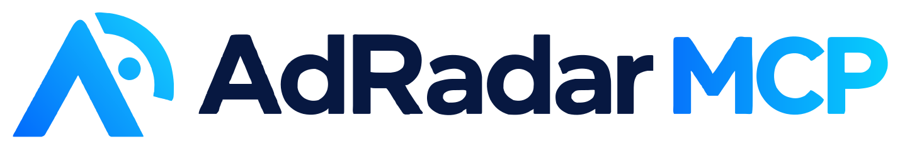

# AdRadar MCP



Competitor ad research inside your AI agent. Ask Claude, ChatGPT or Cursor which Meta and TikTok ads your competitors keep running, and get them scored and explained.

- **Website:** https://adradarmcp.cloud/en/?utm_source=github&utm_medium=directory&utm_campaign=launch_w1
- **MCP endpoint (Streamable HTTP):** `https://adradarmcp.cloud/mcp`
- **Auth:** OAuth 2.1 (claude.ai, ChatGPT) or `Authorization: Bearer <your API key>` (or `?key=<your API key>` for clients that only accept a URL)
- **Pricing:** $0.05 per scan, $1 for 20 scans to try. Credits never expire. Failed or empty scans are refunded automatically.

> This repository holds the public listing (README + `server.json`) for directories and the MCP Registry. AdRadar is a hosted service; the server code is not open source.

## Tools
| Tool | What it does | Cost |
|---|---|---|
| `ad_radar_spy` | Search the public Meta Ad Library by keyword and country. Returns active ads with run time, creative reuse, hook type, angle, audience, CTA strength, urgency, price, guarantee and social proof signals. Default country: US. | 1 credit |
| `ad_radar_tiktok_top` | Top TikTok auction ads from TikTok Creative Center for a country: CTR, likes, budget tier, objective, video URL. | 1 credit |
| `ad_radar_evaluate` | Score any ad copy on a 10-dimension marketing matrix, no scraping. | 1 credit |
| `ad_radar_balance` | Remaining credits. | Free |

## Setup
**Claude (claude.ai / desktop) and ChatGPT:** add a custom connector with URL `https://adradarmcp.cloud/mcp` and sign in when prompted (OAuth 2.1). You can also use `https://adradarmcp.cloud/mcp?key=<your API key>`.

**Claude Code:**
```bash
claude mcp add --transport http adradar https://adradarmcp.cloud/mcp --header "Authorization: Bearer <your API key>"
```

**Cursor / Windsurf / any MCP client (`mcp.json`):**
```json
{
  "mcpServers": {
    "adradar": {
      "url": "https://adradarmcp.cloud/mcp",
      "headers": { "Authorization": "Bearer <your API key>" }
    }
  }
}
```

Get a key: https://adradarmcp.cloud/en/pay?provider=polar&plan=test&utm_source=github&utm_medium=directory&utm_campaign=launch_w1

## Example prompts
- "Find the longest-running protein powder ads in the US and group them by angle."
- "Compare the hooks of my top 3 competitors' active ads and suggest 5 angles nobody is using."
- "Score this ad copy and tell me what to fix before I launch it."
- "What are the top TikTok ads in the UK this month, and what objective are they optimizing for?"

## Data and privacy
AdRadar only reads ads that Meta and TikTok publish in their public ad libraries. Privacy policy: https://adradarmcp.cloud/en/privacy
